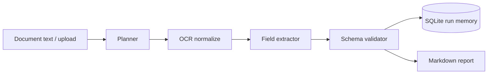

# Document Intelligence Agent

Agentic document pipeline: **plan → OCR normalize → extract fields → validate → persist**.

Designed as a portfolio-ready upgrade path for Azure OCR / OpenAI extraction work — runs fully offline with a rule-based extractor when no API key is set.

## Architecture



## Quick start

```bash
python -m venv .venv && source .venv/bin/activate
pip install -r requirements.txt
cp .env.example .env

python cli.py samples/sample_invoice.txt

uvicorn app.main:app --reload --port 8002
# http://127.0.0.1:8002
```

## API

- `POST /api/extract` — multipart form: `text` and/or `file`
- `GET /api/sample` — sample invoice body

## Author

[Vagish Sharma](https://github.com/VagishSharma01) · https://vagish-sharma.vercel.app
